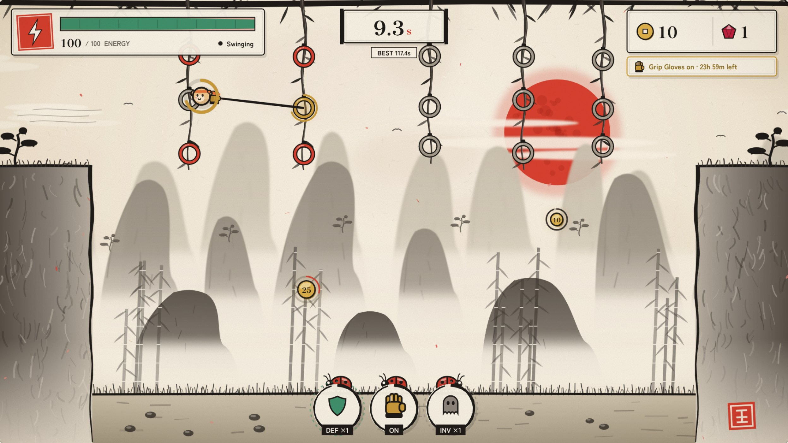

# Swinging Valley

**Swing. Grip. Survive.** A one-finger swinging game for phones (landscape) and desktop browsers.
Lila Games · Game Designer Test · Part 1 · Question 1.

- **Play:** `https://dollyhirpara.github.io/Swinging_Valley/` (Ink & Paper look)
- **Write-up (interactive slides):** `https://dollyhirpara.github.io/Swinging_Valley/presentation.html` (← / → to move, O for overview)
- **Every rule in one place:** [docs/GAME_RULES.md](docs/GAME_RULES.md) (controls, enemies, kills, D1 Grip Gloves, economy)
- **Alternate look:** `golden-hour.html` plays exactly the same game in the earlier Golden Hour art style.

## How to play
- **Tap a hook** to grab it and swing. Each vine has **3 hooks**, so you choose the height. **Tap the next hook** to jump to it before your grip runs out, or tap empty sky to let go and fly. Vine spacing changes every run.
- Hooks have a big touch area (80 units), so a thumb never has to be precise, and it never covers the screen.
- Your **grip** lasts 4 s per hook (7 s with Grip Gloves). The ring around you drains jade → gold → red; in the last 1.6 s you see a countdown. With gloves, staying on one vine builds your swing, up to a cap.
- **Energy is your health:** hits, falls and poison take it; energy bolts give it back. There is no drain for hanging or swinging, but the valley gets more dangerous the longer you last.
- **Spitter bugs** aim when you are slow; at mint speed they lose track of you. **Ninjas** leap at the bottom of your swing; be swinging fast and they miss. **Grumpy birds** puff poison clouds, and they are the only enemy you can kill: fly through one fast to knock it out.
- **Bird hunting:** each bird knocked out pays **15 coins** (no energy). A 2nd or 3rd within 4 s pays ×2 / ×3 (up to 45). Missions: knock out 2 birds today, 5 in one run, 2 in one combo.
- Nearby coins, rubies and bolts drift into your hands. Bubbles (DEF, INV) and the glove button sit at the bottom centre.
- Desktop: click hooks, or `Space` to grab the hook ahead / let go. `G` wears a glove; `1` and `2` trigger the bubbles. `M` (or the 🔊 button on the home screen) turns sound on or off.

## The day-1 hook: Grip Gloves
1. **End of run 1 (day 0):** "Slipping off hooks? Get a better grip." The screen shows your slips, a 4 s vs 7 s demo, the time the gloves arrive (next 08:00) with a live countdown, and the notification you will get.
2. **The timer starts** then. Nothing is locked; play as long as you like.
3. **Day 1:** a notification says *"🧤 Your Grip Gloves are ready!"* The home screen plays a gloved-swing animation, the first glove is **put on automatically** for 24 hours, and you get **3 more free**.
4. After that, tapping the glove button in a run puts one on for **24 hours**. More gloves cost **10 rubies** or come from glove packs.

## Economy (all purchases are simulated in this prototype)
| | Earn | Spend |
|---|---|---|
| **Coins** (soft) | Treasure, bird knockouts (15 × combo, up to 45), missions, 2× Treasure Run, optional ad "double coins" | Max energy, bubble limit, skins, new valleys (full game), 1st revive |
| **Rubies** (hard, rare) | About 1 every 3–4 runs, 2 per daily mission, ad chest, IAP | Grip Gloves (10), 2nd revive (5), 3rd revive (15), extra Treasure Run (5), trails |

- **Revives:** 100 coins, then 5 rubies, then 15 rubies. There is no 4th.
- **Store:** Starter Pack ₹49 (one time), ruby packs ₹29–₹999, glove packs, Glove Club ₹149/month, cosmetic trails. The Valley Pass (₹199/season) is shown but belongs to the full game.
- **Fair-play rules:** no offers on day 0, never an offer mid-run, at most one smart offer per session, everything can be earned without paying, no lives or energy timers.

## Reviewer tips
- **Home → "Reviewer: skip to tomorrow"** skips the wait, so you can see the gloves arrive on day 1, the new daily mission and the day-2 smart offer.
- **"Reset all data (Day 0)"** on the home screen erases everything and starts over as a new player.

## Tech
- One self-contained `index.html`: HTML5 Canvas and plain JavaScript. No libraries, no build step, no server.
- **Art, icons and audio are all generated in code**: a painted golden-hour valley (parallax mountains, baked sun rays, cliffs with strata and moss), lit characters, glow particles, and a WebAudio synth for every sound effect plus a light marimba music loop. No image or sound files to load.
- Rendering adapts to the device: it renders at up to 2× pixel density and steps down automatically if frames get slow. Physics runs on a fixed step either way, so the game plays the same at any frame rate.
- Every gameplay and economy number is in the `TUNING` object at the top of the script.
- Fixed 1/120 s physics step. The game area is 1280×720 logical units, letterboxed to fit the screen.
- Save data lives in `localStorage` (`swinging_valley_v3`), wrapped in try/catch.

---

## Put it on GitHub and get a play link (step by step, no command line)

**1. Create a GitHub account** at <https://github.com/signup> if you don't have one.

**2. Create the repository**
- Click the **+** in the top-right corner, then **New repository**.
- **Repository name:** `swinging-valley`
- Choose **Public** (free GitHub Pages needs a public repo).
- Leave everything else unticked, then click **Create repository**.

**3. Upload the files**
- On the new, empty repo page, click the link **"uploading an existing file"**.
- Open the unzipped `swinging-valley` folder on your computer, select **everything inside it** (`index.html`, `README.md`, `.nojekyll` and the `docs` folder) and drag it into the browser.
  - `.nojekyll` may be hidden because its name starts with a dot. On Mac, press **Cmd + Shift + .** in Finder; on Windows, use **View → Show → Hidden items**. If you can't see it, skip it; the game still works.
- Scroll down and click **Commit changes**. Wait for the upload to finish.

**4. Turn on GitHub Pages**
- In the repo, click **Settings**, then **Pages** in the left sidebar.
- Under **Build and deployment → Source**, choose **Deploy from a branch**.
- Under **Branch**, choose **main** and **/ (root)**, then click **Save**.

**5. Get your links**
- Wait 1–2 minutes, then refresh the Pages settings page. It shows *"Your site is live at …"*.
- Play link: `https://dollyhirpara.github.io/Swinging_Valley/`
- Code link: `https://github.com/dollyhirpara/Swinging_Valley`

**6. Check and personalise**
- Open the play link in a private/incognito window on desktop, and on your phone in landscape.

**Updating later:** in the repo, click **Add file → Upload files**, drop the new file(s) and commit. Pages refreshes in a minute or two.
